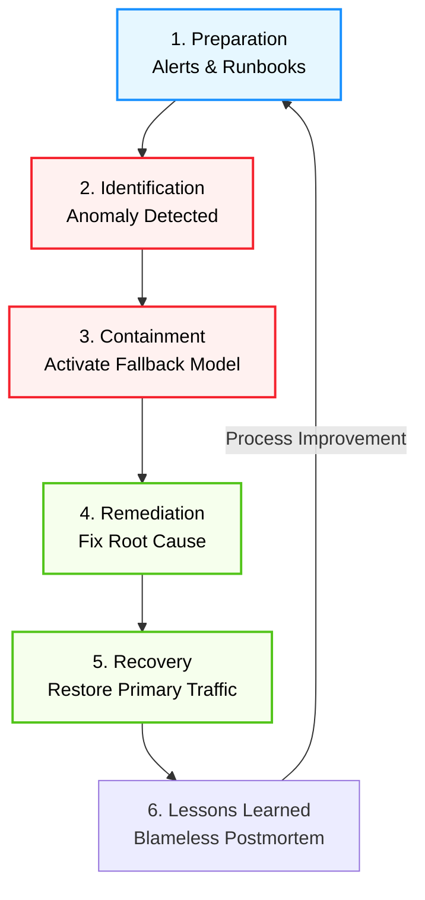

# Incident Response and Postmortems

**Session Time:** 120 minutes

---

## Module Overview
Understand how teams prepare for, respond to, and learn from incidents. Transitioning from development to production introduces real-world risks; therefore, engineering teams must practise documenting root causes and designing postmortems that drive system and process improvements. 

---

## Session Breakdown

| Segment | Topic | Duration (minutes) |
|---|---|---|
| 1 | The Stages of Effective Incident Response | 20 |
| 2 | Structured Approaches to Incident Analysis | 20 |
| 3 | Designing Blameless Postmortems | 20 |
| 4 | Lab: Post-Mortem Simulation | 60 |

---

## Table of Contents
1. The Stages of Effective Incident Response
2. Structured Approaches to Incident Analysis
3. Designing Blameless Postmortems
4. Tooling Context: Reproducing the Failure
5. Lab Reference: Post-Mortem Simulation
6. Wrap-Up and Reflection

---

## 1. The Stages of Effective Incident Response

**Learning Objective:** Outline the stages of effective incident response in AI operations.

When a production AI system fails, chaos is the enemy. Effective incident response relies on a structured, predictable lifecycle that moves a team from panic to resolution. 

In machine learning, an "incident" isn't always a server crash; it can be a silent failure, such as sudden, severe data drift or a model outputting biased predictions due to missing, biased, or insufficient data.

The standard stages of incident response include:
1. **Preparation:** 
    Setting up alerts, runbooks, and defining on-call rotations before a failure occurs.  
2. **Identification:**
    Detecting the issue (e.g., via Grafana alerts) and acknowledging the incident.  
3. **Containment:**
    Stopping the bleeding. In AI, this often means routing traffic to a safe, fallback heuristic model to prevent further damage.  
4. **Remediation & Recovery:**
    Deploying the fix and carefully restoring the primary AI service to full traffic.  
5. **Lessons Learned (Postmortem):** 
    Analyzing the event to prevent recurrence.  

### **Practical Example:  The Rogue Pricing Algorithm**
Imagine an airline's dynamic pricing model suddenly starts pricing international flights at $5.

* *Identification:* 
   The financial monitoring dashboard triggers an alert for a massive drop in revenue per seat.  
* *Containment:* 
   The incident commander immediately executes a "kill switch," bypassing the ML model and applying static, baseline pricing rules.  
* *Remediation:*
   The engineers investigate and find a bug in the feature pipeline feeding the model. They fix the pipeline and redeploy.  

---

## 2. Structured Approaches to Incident Analysis

**Learning Objective:** Apply structured approaches to document and analyse incidents.

Once the immediate fire is out, teams must understand *why* the incident occurred. Treating the symptom (e.g., restarting a crashed server) without understanding the root cause guarantees the incident will happen again. Professionals must utilize structured methodologies, like the [**Five Whys**](https://wa.aws.amazon.com/wellarchitected/2020-07-02T19-33-23/wat.concept.fivewhys.en.html) or the [**Ishikawa (Fishbone) Diagram**](https://wa.aws.amazon.com/wellarchitected/2020-07-02T19-33-23/wat.concept.ishikawadiagram.en.html), to drill down into the underlying system flaws.

> [!NOTE]
> **Five whys**
> 
> Use the five why technique to ensure you have identified the actual causes of a problem. You may need to ask more than five whys to find the causes, and you should consider if a cause could have been prevented. 
> 
> For example, if you see "human error" as a root cause in RCA, it may be indicating a lack of check or fail-safe mechanism. Therefore, you should always ask why the human error was possible.

Often, AI system failures stem from challenges in the earlier phases of the ML workflow, such as Feature Engineering Complexity or Model Generalization.

### **Practical Example:  The "Five Whys" in ML**

> **The Problem:** The recommendation API timed out, causing a 10-minute outage.
1. *Why?* The inference server ran out of memory and crashed.
2. *Why?* The model payload size increased by 400%.
3. *Why?* A new, massive batch of categorical features was passed to the model without dimensionality reduction
4. *Why?* The automated data preprocessing pipeline lacked a data validation check for feature vector sizes.
5. *Why?* (Root Cause) The team did not define baselines or constraints for incoming data during the "Problem Definition & Business Understanding" phase.

---

## 3. Designing Blameless Postmortems

**Learning Objective:** Design postmortems that identify root causes and propose systemic improvements.

A postmortem is a written record of an incident, its impact, the actions taken to mitigate it, the root cause, and the follow-up actions to prevent it from happening again. Crucially, postmortems must be **blameless**. If engineers fear punishment for making a mistake, they will hide information, making it impossible to improve the system. Assume that everyone involved acted with the best intentions based on the information they had at the time.

> A well-designed postmortem translates failure into a roadmap for systemic improvement, directly addressing deployment bottlenecks.

### **Practical Example:  Structuring Action Items**
**A bad action item**: 
 *"Tell Dave to be more careful when updating model weights."* (Blame-focused, relies on human memory).
  
**A good action item**:
 *"Implement automated unit tests and a CI/CD check to ensure model weights do not deviate by more than 10% from the previous version before deployment."* (Systemic, automated, blameless).  

---

## 4. Tooling Context: Reproducing the Failure

Before jumping into the lab, it is critical to understand the tools used in modern incident investigations.

When a production system fails, you cannot safely investigate the bug on the live server without risking further outages.

* **Docker:** 
   This containerization tool allows engineers to pull the exact image of the broken environment locally. By running the system in Docker, you can safely reproduce the crash, step through the logs, and test fixes in a perfectly isolated, reproducible sandbox.  
* **GitHub:**
   Once the root cause is found, GitHub serves two purposes. First, it tracks the code changes (Pull Requests) required to fix the issue. Second, GitHub Issues or GitHub Wikis serve as the permanent, collaborative home for the postmortem document, creating a searchable history of organizational learning.  

---

## 5. Lab Reference: Post-Mortem Simulation

**Lab Objective:** Review a mock incident and create an improvement plan. Learners practise identifying root causes, documenting lessons learned, and proposing reliability enhancements.

*Note: Please refer to the dedicated Lab Guide for the mock incident scenario details, timeline logs, and the postmortem document template.*

**Required Tools:**

* GitHub (for documentation and issue tracking)
* Docker (for environment simulation)

---

## 6. Wrap-Up and Reflection

**Reflection Questions:**

1. How does a "blameless" culture actually improve the technical reliability of an AI system?
2. Looking at the five phases of the ML workflow (Problem Definition to Deployment & Monitoring), which phase do you think is most often the hidden root cause of production incidents, and why?
