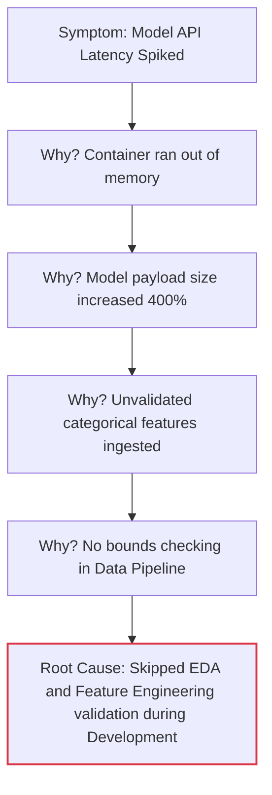

# Instructor Guide: Incident Response and Postmortems

## Module Overview

In this module, students learn how to manage the chaos of a production failure in an AI system. The focus is on how teams prepare for, respond to, and learn from incidents. A key differentiator in this curriculum is teaching professionals that AI incidents are often "silent" (e.g., data drift, prediction skew) rather than noisy server crashes. Learners will practise documenting root causes and designing postmortems that drive systemic improvements.

## Learning Objectives

By the end of this session, students will be able to:

- Outline the stages of effective incident response in AI operations.
- Apply structured approaches to document and analyse incidents.
- Design postmortems that identify root causes and propose systemic improvements.

## Session Pacing Guide (120 Minutes total)

| Duration   | Segment                               | Instructor Action                                                                                                                       |
|:-----------|:--------------------------------------|:----------------------------------------------------------------------------------------------------------------------------------------|
| **10 min** | **The Stages of Incident Response**   | Outline the Incident Response lifecycle. Discuss how AI failures differ from traditional software crashes.                              |
| **25 min** | **Structured Approaches to Analysis** | Whiteboard a "Five Whys" analysis. Connect root causes back to the five distinct, iterative phases of the industrial AI/ML workflow.    |
| **25 min** | **Blameless Postmortems & Tooling**   | Discuss the cultural shift to "blameless" reviews. Explain how Docker and GitHub are used to safely reproduce and document the failure. |
| **60 min** | **Lab: Post-Mortem Simulation**       | Facilitate the role-play lab. Circulate to ensure students aren't blaming individuals in their write-ups, but focusing on system flaws. |

---

## Delivery Notes & Teaching Tips

### 1. The Stages of Effective Incident Response

- **The "Silent Failure" Concept:** 
   Software engineers are used to APIs returning `HTTP 500` when broken. Emphasize that in AI, an API might return `HTTP 200 OK` but deliver terrible predictions because of missing, biased, or insufficient data.  
- **Containment over Perfection:** 
   Teach students that the goal during an active incident is _containment_ (e.g., routing to a fallback model), not finding the perfect code fix immediately.  
- **Visual Aid:** 
   Use the board to draw an Incident Command System. Show the distinct roles: Incident Commander, Communications Lead, and Operations Lead.  

### 2. Structured Approaches to Incident Analysis

- **Root Cause vs. Proximate Cause:** 
    Use an Ishikawa (Fishbone) diagram to show how contributing factors stack up. The server crashing is just the proximate cause; the root cause is usually a missing process or validation step.
- **Mapping to the ML Workflow:** 
    When demonstrating the "Five Whys," deliberately trace the failure back to the early stages of the ML lifecycle. Many production bottlenecks stem from poor Problem Definition & Business Understanding.  

### 3. Designing Blameless Postmortems

- **Culture Check:** 
   This is often the hardest part for experienced professionals. Define "blameless": We assume everyone did the best they could with the information they had. If a developer deployed a broken model, the failure is in the CI/CD pipeline that _allowed_ the broken model to reach production.  
- **Tooling Context (Docker & GitHub):**
   Explain _why_ these tools are in the lab. Docker is used to safely recreate the "crime scene" locally without breaking production again. GitHub Issues/Wikis are used because a postmortem in a hidden Word document provides zero systemic value; it must be searchable.  

---

## Lab Guide: Post-Mortem Simulation

**Lab Objective:** Review a mock incident and create an improvement plan. Learners practise identifying root causes, documenting lessons learned, and proposing reliability enhancements using Docker and GitHub.

### Setup

- Ensure students have cloned the mock-incident repository from GitHub.
- Ensure Docker is running so students can spin up the simulated broken environment to inspect logs.

### Common Student Issues & Solutions

| Issue                                                                                                  | Solution                                                                                                                                                                                                                                |
|--------------------------------------------------------------------------------------------------------|-----------------------------------------------------------------------------------------------------------------------------------------------------------------------------------------------------------------------------------------|
| Students jump straight to writing a fix instead of containing the issue or documenting the timeline.   | Enforce the role-play. Tell them, "Production is still burning. Your fix will take 30 minutes to build. How do you stop the bleeding _right now_?"                                                                                      |
| "Action Items" in the postmortem are directed at people (e.g., "Tell Sarah to double-check the data"). | Reject these action items. Force the students to rewrite them as systemic changes (e.g., "Implement an automated schema validation check in the pipeline").                                                                             |
| AI hallucinations during root cause analysis                                                           | If a student asks their AI tool to analyze the mock logs and it gives a complex or weird answer, teach students to cross-reference.  "Ask the AI: _'Are you sure? Can you verify that against standard HTTP status definitions?'_". |

### Debrief Questions

At the end of the lab, ask:

1. "Did treating the incident review as 'blameless' change the types of root causes you discovered?"
2. "How could you use Prometheus and Grafana (from our previous module) to automatically detect the issue we simulated today before a customer reported it?"

---

## Resources for the Instructor

- **Reference:** 
  - [Google SRE Book - Postmortem Culture: Learning from Failure](https://sre.google/sre-book/postmortem-culture/)
  - [Atlassian Incident Management Handbook](https://www.atlassian.com/incident-management)
- **AI Prompt Bank:** Keep these handy to share with students who are stuck during the lab:
  - _"Act as a strict SRE manager. Review this postmortem action item: 'Developers must be more careful.' Rewrite it to be a systemic, automated constraint."_
  - _"I have a Docker container that is exiting with code 137. Explain what this means in the context of memory limits, and how I can investigate it."_
